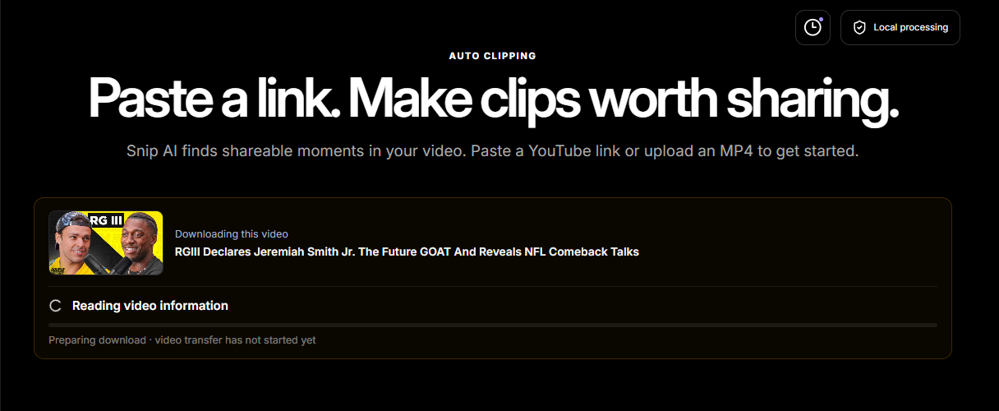
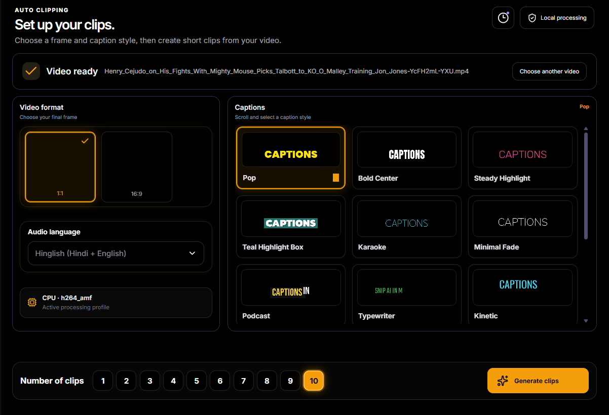
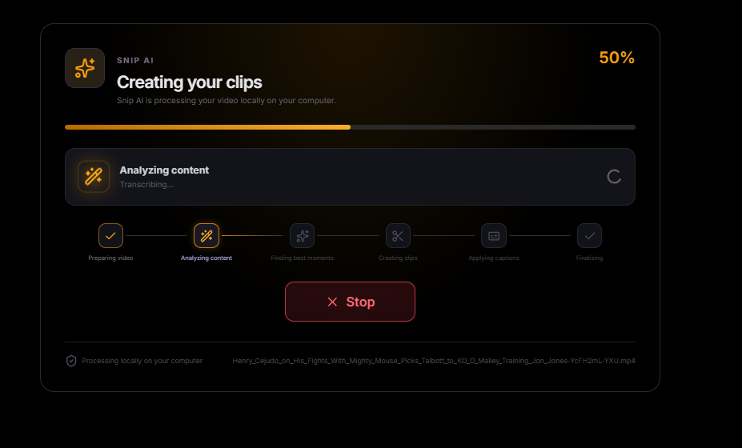
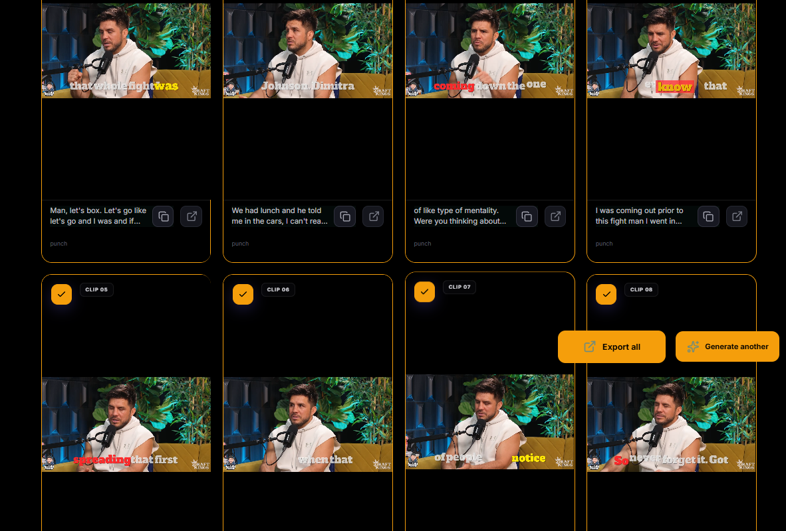
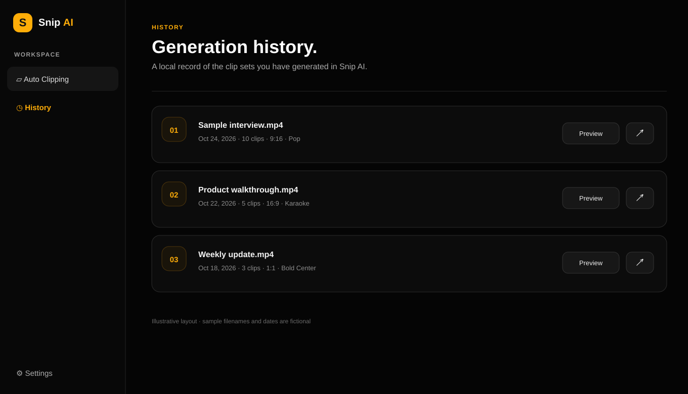
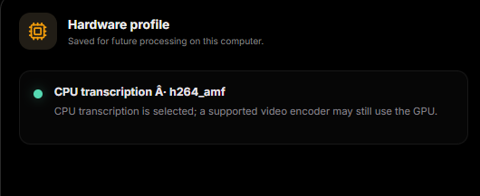
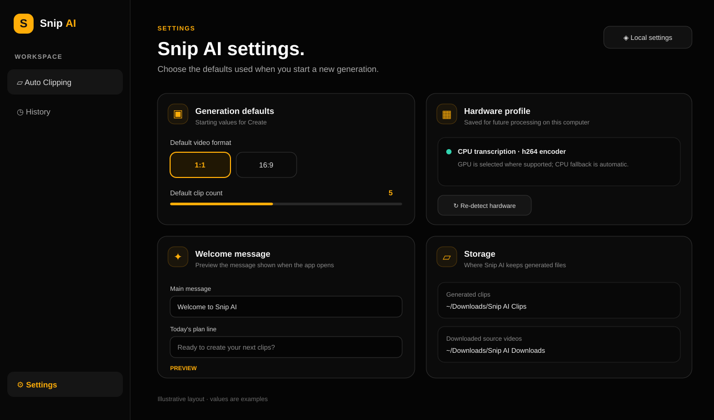
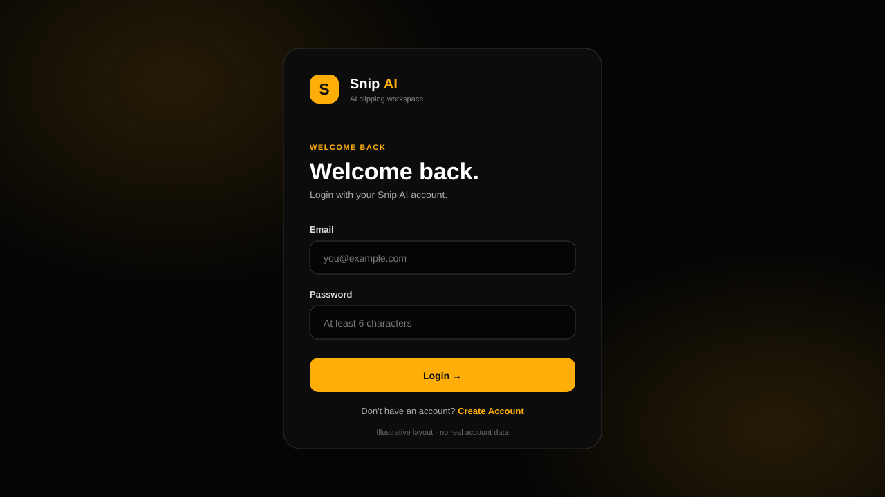

# Snip AI

**Turn long videos into short, captioned clips on Windows.**

Snip AI is a desktop video clipping tool. Choose a local MP4 or paste a YouTube link, set the clip format and caption style, then generate, preview, and export short clips from the app.

  <a href="https://github.com/rajtyagigi7078-sketch/snipai-v2/releases/download/v0.1.4-windows-ffmpeg-fix/Snip.AI_0.1.4_x64-setup.exe"><strong>Download Snip AI for Windows</strong></a>
  ·
  <a href="https://github.com/rajtyagigi7078-sketch/snipai-v2/releases/tag/v0.1.4-windows-ffmpeg-fix">Release notes</a>

## What it does

Snip AI takes a long-form video through a complete clipping workflow:

1. **Bring in a video** by selecting an MP4 or pasting a YouTube URL. For link downloads, the app shows the video information and transfer progress before using the downloaded file.
2. **Set up the clips** by selecting a frame format, audio language, caption theme, and how many clips to create.
3. **Find moments and create clips.** Snip AI transcribes and analyzes the video, then renders short clips with animated captions.
4. **Review and export.** Preview the generated clips, copy suggested social captions, open the output folder, or export selected clips.

## Features

- **Frame formats:** square 1:1 and landscape 16:9.
- **Caption themes:** Pop, Bold Center, Steady Highlight, Teal Highlight Box, Karaoke, Minimal Fade, Podcast, Typewriter, Kinetic, Punch, Sunny Stack, Violet Pill, Dual-Line Lyric, Reel Karaoke, and Soft Lyric.
- **Clip count:** generate between 1 and 10 clips per run.
- **Language-aware transcription:** supports the app's English and Hinglish workflows.
- **Local media processing:** transcription, clip rendering, and caption rendering run on the user's computer using the bundled runtime.
- **Hardware-aware processing:** uses a supported GPU when available; CPU processing is the fallback.
- **Download and output management:** downloaded source videos and generated clips are saved in the user's Downloads folders.
- **Generation history and settings:** revisit completed clip sets and save defaults on the device.

## App screens

The gallery below follows the main workflow from video import through settings. The PNG captures are cropped to the app workspace to keep account details out of the repository. The History and Account SVGs are UI layout previews with fictional sample data, not live account or generation records.

<strong>1. Import a video</strong>

Paste a YouTube URL or choose a local video. Link downloads show the detected title and transfer state.

<strong>2. Configure clips and captions</strong>

Choose an output format, audio language, caption theme, and clip count.

<strong>3. Follow generation progress</strong>

The progress screen shows the current processing stage while Snip AI prepares the clips.

<strong>4. Preview and export clips</strong>

Review the generated clip cards, select clips, and export the results.

<strong>5. Review history</strong>

Completed generations are kept in the app's local history so a clip set can be opened again.

<strong>6. Manage settings and hardware</strong>

Set defaults, review the detected processing profile, and request hardware detection again.

<strong>7. Sign in or create an account</strong>

Account access is separate from local video processing.

## Windows download

- **Latest installer:** [Snip AI v0.1.4 for Windows (64-bit)](https://github.com/rajtyagigi7078-sketch/snipai-v2/releases/download/v0.1.4-windows-ffmpeg-fix/Snip.AI_0.1.4_x64-setup.exe)
- **Release page:** [v0.1.4 Windows — FFmpeg fix](https://github.com/rajtyagigi7078-sketch/snipai-v2/releases/tag/v0.1.4-windows-ffmpeg-fix)
- **Requirements:** Windows 10 or 11, 64-bit. The installer includes the desktop runtime and media-processing dependencies.

Download the installer, open the `.exe`, follow the setup steps, and launch Snip AI from the Start Menu.

## Processing and network use

Video transcription, clip selection, rendering, and caption generation run locally. Snip AI uses the network for account access and for downloading videos from supported URLs. YouTube may restrict access, require sign-in, or rate-limit requests; downloading a local video file is an alternative when a link is unavailable.

Only download videos you have permission to use. Snip AI does not promise that every URL will be available to download.

## Repository scope

This repository is the public release and product-documentation page for Snip AI. It contains the installer releases, this product overview, and UI images. The application source and its large bundled runtime are maintained separately from this lightweight release repository.
